##  {.hero-slide}

:::::::: title-hero
::: eyebrow
INF449 · Fotografía Computacional · Proyecto final
:::

::: hero-paper
Comprimir la captura:\
cámara de un píxel y reconstrucción 2D
:::

::: hero-authors
Francisco Alfaro · Ayrton Perez
:::

::: hero-meta
Universidad Técnica Federico Santa María · Departamentos de Electrónica e Informática

Código: github.com/fralfaro/inf449-proyecto
:::
::::::::

::: notes
Presentamos un estudio de simulación de una cámara de un píxel. La pregunta es cuántas mediciones por vista se pueden quitar antes de que la calidad caiga. El alcance de este trabajo es 2D; el paso a 3D con Gaussian Splatting es la motivación y el trabajo futuro. Estructura: contexto y estado del arte, modelo y método, experimentos, el vínculo con 3DGS, y conclusiones.
:::

## Una cámara de un píxel cambia sensor por mediciones

::: eyebrow
Contexto · Problema y pregunta
:::

:::::: problem-text
::: fragment
[Problema]{.kicker}

Un sensor matricial es caro en ciertas bandas. La **SPC** usa **un solo detector** y una secuencia de **patrones** de iluminación \[1, 2\].
:::

::: fragment
[Brecha]{.kicker}

El precio es el tiempo: **cada vista exige muchas mediciones**, y una escena 3D necesita cientos de vistas.
:::

::: fragment
[Pregunta]{.kicker}

¿Cuánta calidad se pierde al **reducir las mediciones por vista**, y qué patrón y qué reconstrucción lo soportan mejor?
:::
::::::

::: {.image-frame .problem-illustration}
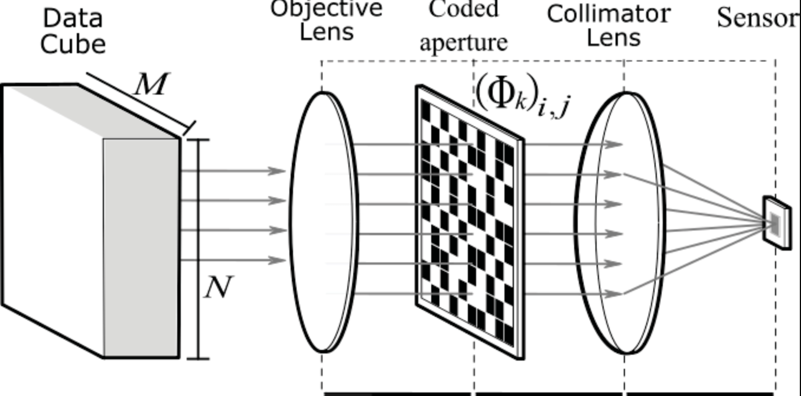{fig-alt="Esquema de una cámara de un píxel: escena, patrón codificado, lente y detector único."}
:::

::: notes
La SPC proyecta patrones sobre la escena y mide un solo número por patrón. Reconstruir una imagen exige resolver un problema inverso. Si además queremos una escena 3D, hay que repetirlo por cada vista, así que el costo se multiplica.
:::

## Estado del arte: de la arquitectura de Rice a la imagen 3D

::: eyebrow
Contexto · Single Pixel Camera
:::

```{=html}
<table class="table-roomy" aria-label="Hitos de la cámara de un píxel">
<thead><tr><th>Año</th><th>Trabajo</th><th>Aporte</th></tr></thead>
<tbody>
<tr><td>2006</td><td>Donoho [3]</td><td>Base teórica: muestreo comprimido y recuperación con ℓ₁</td></tr>
<tr><td>2008</td><td>Duarte et al. [1]</td><td>Cámara de un píxel: un DMD y un fotodiodo con muestreo comprimido</td></tr>
<tr><td>2013</td><td>Sun et al. [4]</td><td>Imagen 3D con detectores de un píxel</td></tr>
<tr><td>2017</td><td>Zhang et al. [5]</td><td>Hadamard frente a Fourier para imagen de un píxel</td></tr>
<tr><td>2019</td><td>Edgar, Gibson, Padgett [2] · Yu [6]</td><td>Revisión del campo; orden <em>cake-cutting</em> sub-Nyquist</td></tr>
</tbody>
</table>
```

::: notes
La idea de cámara de un píxel con muestreo comprimido viene de Rice: un DMD proyecta patrones y un fotodiodo mide. Duarte et al. lo formalizaron como cámara. Sun et al. extendieron a 3D con varios detectores. Zhang, Sun y Yu estudian qué base y qué orden de patrones necesitan menos mediciones. Edgar et al. es la revisión de referencia.
:::

## Cada medición es un producto interno con un patrón

::: eyebrow
Método · Modelo de medición
:::

:::: two-col
::: {.image-frame}
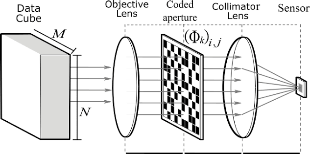{fig-alt="Esquema de una cámara de un píxel: escena, lente objetivo, apertura codificada con el patrón, lente colimadora y sensor único."}

::: image-caption
Arquitectura de una SPC. Fuente: material del curso.
:::
:::

::: equation-card
[Medición con ruido]{.eq-label}

$$\mathbf{y}=\mathbf{\Phi}\mathbf{x}+\mathbf{n},\qquad r=\frac{M}{N}$$

[Un DMD solo tiene máscaras {0,1}]{.eq-label}

$$\mathbf{P}=\tfrac{1}{2}(\mathbf{1}+\mathbf{H}),\qquad c = 2y-\mathrm{DC}$$
:::
::::

::::: {.points .points-row}
::: fragment
$\mathbf{x}$ es la vista (rejilla **512×1024**, $N=524\,288$); $r$ es la **razón de medición**.
:::

::: fragment
Se mide también el nivel **DC** para recuperar el coeficiente en ±1.
:::

::: fragment
Esa corrección **duplica el ruido**, un efecto que suele omitirse.
:::
:::::

::: notes
La matriz Phi no se almacena: sería de 524 mil al cuadrado. Se aplica con una transformada rápida de Walsh-Hadamard en GPU, que cuesta 3.4 milisegundos por vista de tres canales. Como el espejo solo enciende o apaga, se miden máscaras de 0 y 1 y se corrige con una medición de nivel DC.
:::

## Muestreo comprimido: pocas mediciones si la imagen es escasa

::: eyebrow
Método · Fundamento teórico \[3\]
:::

:::: two-col
::: equation-card
[Si $\mathbf{x}$ es $K$-escasa y $\mathbf{\Phi}$ cumple RIP]{.eq-label}

$$M\ \ge\ C\,K\log\!\frac{N}{K}$$

[Recuperación]{.eq-label}

$$\hat{\mathbf{x}}=\arg\min_{\mathbf{x}}\ \|\mathbf{x}\|_1\ \ \text{s.a.}\ \ \|\mathbf{\Phi}\mathbf{x}-\mathbf{y}\|_2\le\varepsilon$$
:::

::: points
::: fragment
Las imágenes naturales son escasas en una base adecuada (wavelet, gradiente).
:::

::: fragment
En la práctica se usa **TV**: la escasez está en el gradiente, no en los píxeles.
:::

::: fragment
Con un patrón ordenado la teoría no aplica tal cual; se evalúa de forma **empírica**.
:::
:::
::::

::: notes
El resultado clásico dice que, con una matriz que cumple la propiedad de isometría restringida, bastan del orden de K log N sobre K mediciones. En imágenes usamos variación total porque los gradientes son escasos. Con Hadamard ordenado no hay garantía de RIP, por eso medimos empíricamente.
:::

## La base de Hadamard: ortogonal, binaria y rápida

::: eyebrow
Método · Patrones
:::

:::: two-col
::: {.image-frame}
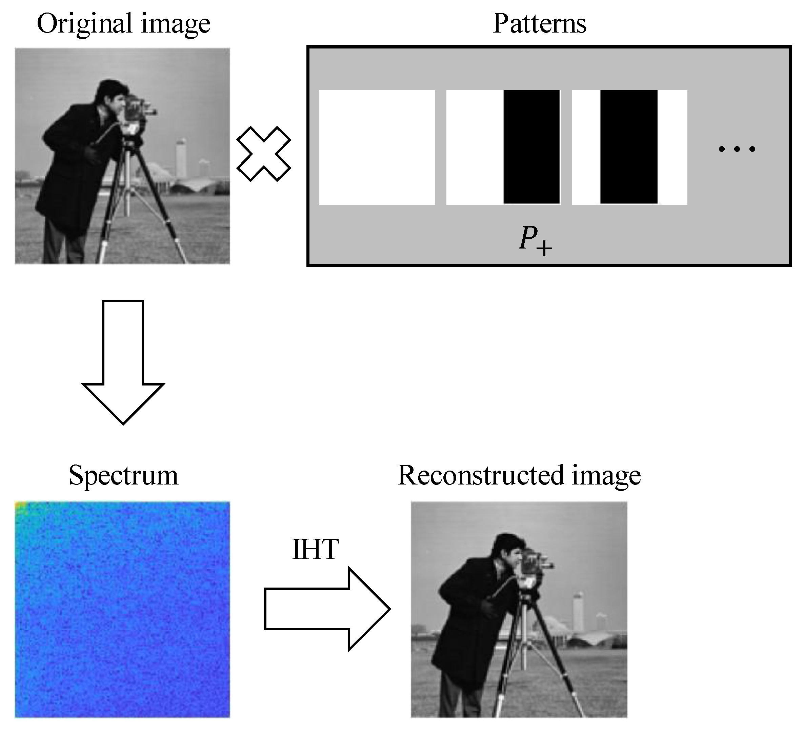{fig-alt="Patrones de la base de Hadamard ordenados por frecuencia."}

::: image-caption
Patrones de Hadamard. Fuente: material del curso.
:::
:::

::: equation-card
[Construcción de Sylvester]{.eq-label}

$$\mathbf{H}_{2n}=\begin{bmatrix}\mathbf{H}_n&\mathbf{H}_n\\\mathbf{H}_n&-\mathbf{H}_n\end{bmatrix},\quad \mathbf{H}_1=[1]$$

[Ortogonalidad]{.eq-label}

$$\mathbf{H}\mathbf{H}^{\top}=N\,\mathbf{I}\ \Rightarrow\ \mathbf{\Phi}\mathbf{\Phi}^{\top}=\mathbf{I}$$

Exige $N$ potencia de 2 (de ahí la rejilla 512×1024) y permite una transformada rápida.
:::
::::

::: notes
Hadamard se construye por recursión y sus filas son ortogonales; con la normalización adecuada, Phi por Phi transpuesta es la identidad. Eso hace que la reconstrucción directa sea la solución de mínima norma. La condición de potencias de 2 obliga a usar una rejilla de 512 por 1024.
:::

## Un DMD solo muestra 0 y 1: patrón positivo y negativo

::: eyebrow
Método · Hadamard en un DMD
:::

:::: two-col
::: {.image-frame}
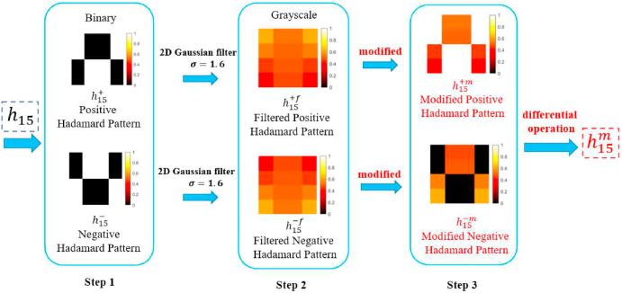{fig-alt="Un patrón de Hadamard se separa en un patrón positivo y uno negativo binarios, se filtra con un filtro gaussiano de sigma 1,6, se modifica y se combina mediante una operación diferencial."}

::: image-caption
Separación en patrón positivo y negativo, con filtro gaussiano. Fuente: figura del material de ejemplo; verificar.
:::
:::

::: equation-card
[Patrón ±1 con máscaras {0,1}]{.eq-label}

$$\mathbf{h}=\mathbf{h}^{+}-\mathbf{h}^{-},\qquad \mathbf{h}^{\pm}\in\{0,1\}^{N}$$

[Esquema usado aquí: un patrón + referencia DC]{.eq-label}

$$c=2y-y_{\mathrm{DC}}$$
:::
::::

::::: {.points .points-row}
::: fragment
La versión **diferencial** mide $\mathbf{h}^{+}$ y $\mathbf{h}^{-}$: el doble de mediciones.
:::

::: fragment
Aquí se mide **un patrón y el nivel DC**: menos mediciones, pero el ruido se duplica.
:::

::: fragment
La óptica **difumina** el patrón; la figura lo modela con un filtro gaussiano ($\sigma=1{,}6$).
:::
:::::

::: notes
El espejo solo enciende o apaga, así que un patrón con valores más uno y menos uno se descompone en dos patrones binarios. La figura muestra la versión diferencial y el efecto del desenfoque de la óptica. En este trabajo no modelamos el desenfoque; usamos un único patrón y una referencia DC, que cuesta la mitad de mediciones pero duplica el ruido.
:::

## El orden de los patrones decide qué se mide primero

::: eyebrow
Método · Órdenes de patrones \[5, 6\]
:::

:::::: problem-text
::: fragment
[Cake-cutting]{.kicker}

Ordena las filas por el **número de bloques conexos** del patrón: primero las bajas frecuencias. Un patrón separable $w_i(x)\,w_j(y)$ tiene $(s_i+1)(s_j+1)$ bloques.
:::

::: fragment
[Russian dolls]{.kicker}

Orden por **escala** anidada; buena resolución con pocas mediciones.
:::

::: fragment
[Fourier y aleatorio]{.kicker}

Fourier necesita **4 pasos** por coeficiente (4N mediciones); el binario aleatorio no prioriza frecuencias y se implementa con permutación + Hadamard + submuestreo.
:::
::::::

::: note-box
En este trabajo se comparan **Hadamard ordenado (cake-cutting)** y **binario aleatorio estructurado**.
:::

::: notes
El orden importa porque con pocas mediciones solo se captura una parte de las frecuencias. Un Bernoulli i.i.d. denso a esta resolución ocuparía 1.7 GB al 5 por ciento y 17 GB al 50, por eso se usa una matriz estructuralmente aleatoria.
:::

## Ruido del detector: Poisson, lectura y cuantización

::: eyebrow
Método · Modelo físico
:::

:::: two-col
::: equation-card
[Medición del fotodiodo]{.eq-label}

$$y_i=Q_b\!\left(\frac{\mathrm{Pois}\!\big(\gamma\,\langle\mathbf{p}_i,\mathbf{x}\rangle\big)}{\gamma}+\mathcal{N}(0,\sigma^2)\right)$$

[Coeficiente en ±1]{.eq-label}

$$c_i = 2y_i-y_{\mathrm{DC}}\ \Rightarrow\ \sigma_c = 2\sigma_y$$
:::

::: points
::: fragment
$\gamma=10^{9}$ fotones por patrón; ruido de lectura $\sigma=10^{-5}$.
:::

::: fragment
$Q_b$: cuantización de **16 bits**; la referencia DC se promedia 16 veces.
:::

::: fragment
Con estos parámetros el ruido no domina: el límite es la **cantidad de mediciones**.
:::
:::
::::

::: notes
El ruido de disparo es Poisson, hay ruido de lectura gaussiano y el ADC cuantiza. Con estos valores el ruido es bajo; el estudio de ruido del notebook explora niveles más agresivos. El factor 2 viene de pasar de máscaras 0 y 1 a coeficientes en menos uno y uno.
:::

## Directa: mínima norma. Regularizada: variación total

::: eyebrow
Método · Reconstrucción \[7\]
:::

:::: two-col
::: equation-card
[Directa]{.eq-label}

$$\hat{\mathbf{x}}=\mathbf{\Phi}^{\top}\mathbf{y}$$

Equivale a rellenar con ceros los coeficientes no medidos.
:::

::: equation-card
[Regularizada con TV]{.eq-label}

$$\hat{\mathbf{x}}=\arg\min_{\mathbf{x}}\ \tfrac12\|\mathbf{\Phi}\mathbf{x}-\mathbf{y}\|_2^2+\lambda\,\mathrm{TV}(\mathbf{x})$$

$$\mathrm{TV}(\mathbf{x})=\sum_{i,j}\sqrt{(\nabla_h x)_{ij}^2+(\nabla_v x)_{ij}^2}$$
:::
::::

::: note-box
$\lambda$ se elige con vistas de **entrenamiento** (rejilla $10^{-3}$ a $3\times10^{-2}$) y se fija antes de evaluar.
:::

::: notes
La TV de Rudin, Osher y Fatemi penaliza la variación del gradiente, preserva bordes y suaviza zonas planas. La directa no usa prior: es la proyección sobre los coeficientes medidos. Elegir lambda en vistas de entrenamiento evita sesgar la evaluación.
:::

## FISTA resuelve el problema con convergencia acelerada

::: eyebrow
Método · Algoritmo \[8\]
:::

:::: two-col
::: equation-card
[Paso proximal con el gradiente del ajuste]{.eq-label}

$$\mathbf{x}_k=\mathrm{prox}_{\frac{\lambda}{L}\mathrm{TV}}\!\Big(\mathbf{z}_k-\tfrac1L\mathbf{\Phi}^{\top}(\mathbf{\Phi}\mathbf{z}_k-\mathbf{y})\Big)$$

[Aceleración]{.eq-label}

$$t_{k+1}=\frac{1+\sqrt{1+4t_k^2}}{2}$$

$$\mathbf{z}_{k+1}=\mathbf{x}_k+\frac{t_k-1}{t_{k+1}}(\mathbf{x}_k-\mathbf{x}_{k-1})$$
:::

::: points
::: fragment
Convergencia $O(1/k^2)$ frente a $O(1/k)$ del gradiente proximal simple.
:::

::: fragment
El proximal de TV se resuelve con **FGP** (gradiente rápido proyectado), en lotes en GPU.
:::

::: fragment
Con $\mathbf{\Phi}\mathbf{\Phi}^{\top}=\mathbf{I}$ el paso es $L=1$. Tope de **100 iteraciones**.
:::
:::
::::

::: notes
FISTA añade un término de momento al gradiente proximal. El proximal de TV no tiene forma cerrada y se resuelve con el método FGP de Beck y Teboulle. Todo se hace por lotes en GPU, de modo que una vista tarda alrededor de un segundo.
:::

## Diseño experimental: escenas, condiciones y recursos

::: eyebrow
Experimentos · Diseño
:::

```{=html}
<table class="table-roomy" aria-label="Resumen del diseño experimental">
<thead><tr><th>Elemento</th><th>Valor</th></tr></thead>
<tbody>
<tr><td>Escenas</td><td>Truck, Train (Tanks and Temples); DrJohnson, Playroom (Deep Blending) [10]</td></tr>
<tr><td>Vistas</td><td>24 por escena, equiespaciadas</td></tr>
<tr><td>Razones de medición</td><td>5 %, 10 %, 25 %, 50 %</td></tr>
<tr><td>Patrones × métodos</td><td>Hadamard ordenado, aleatorio × directa, TV</td></tr>
<tr><td>Control</td><td>Solo remuestreo a 512×1024 (sin SPC)</td></tr>
<tr><td>Hardware</td><td>RTX 4060 Laptop 8 GB · PyTorch 2.11 + CUDA 12.8</td></tr>
<tr><td>Tiempo</td><td>12–15 min por escena (24 vistas, todas las condiciones); 53 min las cuatro</td></tr>
</tbody>
</table>
```

::: notes
El control de solo remuestreo aísla la pérdida que no viene de la SPC: pasar a la rejilla de potencias de 2 y guardar en JPEG. Las escenas se simulan con la misma semilla. Los tiempos son los medidos: entre 12 y 15 minutos por escena, 53 minutos en total.
:::

## Métricas: error de señal, estructura y percepción

::: eyebrow
Experimentos · Métricas
:::

:::: two-col
::: equation-card
[PSNR]{.eq-label}

$$\mathrm{PSNR}=10\log_{10}\frac{1}{\mathrm{MSE}(\hat{\mathbf{x}},\mathbf{x})}\ \text{dB}$$

[SSIM]{.eq-label}

$$\mathrm{SSIM}=\frac{(2\mu_a\mu_b+c_1)(2\sigma_{ab}+c_2)}{(\mu_a^2+\mu_b^2+c_1)(\sigma_a^2+\sigma_b^2+c_2)}$$
:::

::: points
::: fragment
**PSNR**: error de píxel; sensible a ruido de baja amplitud.
:::

::: fragment
**SSIM**: estructura local (luminancia, contraste, correlación).
:::

::: fragment
**LPIPS-VGG**: distancia entre características de una red; mide **percepción**.
:::

::: fragment
Siempre contra la imagen **original**, a la resolución final.
:::
:::
::::

::: notes
Usamos las tres métricas porque se complementan: PSNR cae por ruido aunque la estructura se vea bien; SSIM mide estructura; LPIPS se acerca más a lo que percibe una persona. Todas se calculan contra la imagen original y con una única función para todas las condiciones.
:::

## Con 25 % de las mediciones la escena sigue reconocible

::: eyebrow
Resultados · Truck, Hadamard + TV
:::

::: {.image-frame .fig-wide}
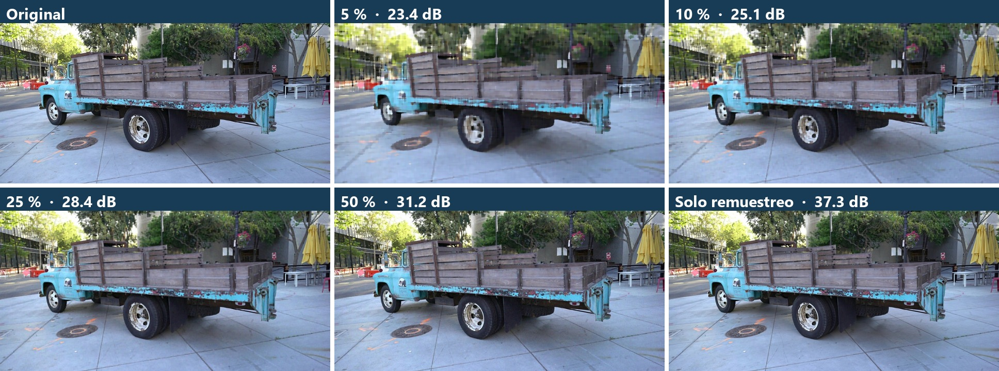{fig-alt="Misma vista de Truck: original, reconstrucciones Hadamard más TV al 5, 10, 25 y 50 por ciento y control de solo remuestreo, con su PSNR."}
:::

::::: {.points .points-row}
::: fragment
Al **5 %** aparecen bloques en zonas de textura (follaje).
:::

::: fragment
Desde el **25 %** los bordes del camión se conservan.
:::

::: fragment
Vista 000001; el PSNR es el de esa vista.
:::
:::::

::: notes
Las figuras salen de la corrida paper24, vista 000001 de Truck. El PSNR es el de esa vista, no el promedio. El control de solo remuestreo muestra el techo del experimento.
:::

## Calidad frente a razón de medición

::: eyebrow
Resultados · Truck, 24 vistas
:::

::: {.image-frame}
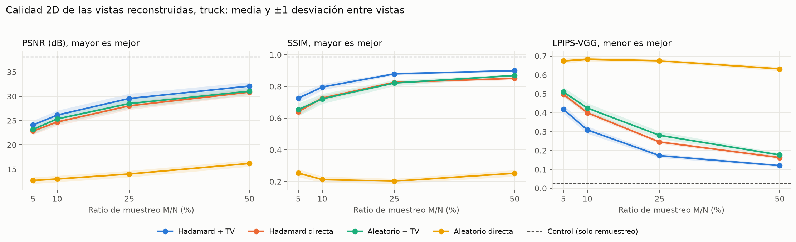{fig-alt="PSNR, SSIM y LPIPS frente a la razón de medición para Hadamard y aleatorio, con reconstrucción directa y TV."}
:::

::: image-caption
Media y ±1 desviación entre vistas. Línea punteada: control.
:::

::: notes
Hadamard con TV domina en las tres métricas. Los patrones aleatorios con reconstrucción directa quedan muy por debajo; con TV se acercan a Hadamard a razones altas.
:::

## La regularización importa más con patrones aleatorios

::: eyebrow
Resultados · Truck, PSNR medio (dB) en 24 vistas
:::

```{=html}
<table class="table-roomy" aria-label="PSNR medio por patrón, método y razón en Truck">
<thead><tr><th>Patrón · método</th><th class="group-start">5 %</th><th>10 %</th><th>25 %</th><th>50 %</th></tr></thead>
<tbody>
<tr><td>Hadamard · directa</td><td class="group-start">22,84</td><td>24,72</td><td>28,04</td><td>30,85</td></tr>
<tr class="ours"><td>Hadamard · TV</td><td class="group-start best">24,11</td><td class="best">26,13</td><td class="best">29,55</td><td class="best">32,10</td></tr>
<tr><td>Aleatorio · directa</td><td class="group-start">12,68</td><td>12,99</td><td>14,02</td><td>16,19</td></tr>
<tr><td>Aleatorio · TV</td><td class="group-start">23,18</td><td>25,35</td><td>28,49</td><td>31,05</td></tr>
<tr class="baseline"><td>Control (solo remuestreo)</td><td class="group-start" colspan="4">38,07</td></tr>
</tbody>
</table>
```

::::: result-foot
::: {.result-stat .fragment}
[≈ +1,3 dB]{.stat-value}

[TV frente a directa, con Hadamard]{.stat-label}
:::

::: fragment
Con patrones aleatorios, la directa no sirve (**13–16 dB**); la TV la lleva a **23–31 dB**.
:::
:::::

::: notes
Cifras de summary_2d.csv, condición todas las vistas (n = 24), escena Truck. La siguiente diapositiva muestra el agregado de las cuatro escenas.
:::

## Con cuatro escenas la tendencia se mantiene

::: eyebrow
Resultados · Media de 4 escenas × 24 vistas
:::

::: {.image-frame}
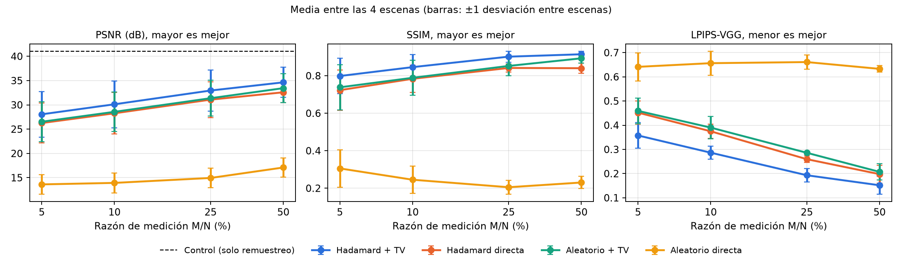{fig-alt="PSNR, SSIM y LPIPS medios de las cuatro escenas frente a la razón de medición."}
:::

::::: result-foot
::: {.result-stat .fragment}
[28,1 → 34,6 dB]{.stat-value}

[Hadamard + TV, del 5 % al 50 %]{.stat-label}
:::

::: fragment
La TV aporta **1,8 a 2,1 dB** sobre la directa; el aleatorio + TV llega a **33,4 dB** al 50 %.
:::
:::::

::: notes
Medias sobre Truck, Train, DrJohnson y Playroom, 24 vistas cada una. Las barras muestran la variación entre escenas, que es grande: con Hadamard y TV al 5 por ciento el PSNR va de 23,9 dB en Train a 32,6 dB en DrJohnson. Una hipótesis es la resolución nativa frente a la rejilla; no está verificada.
:::

## La escena influye más que el método

::: eyebrow
Resultados · Hadamard + TV por escena
:::

:::: two-col
::: {.image-frame}
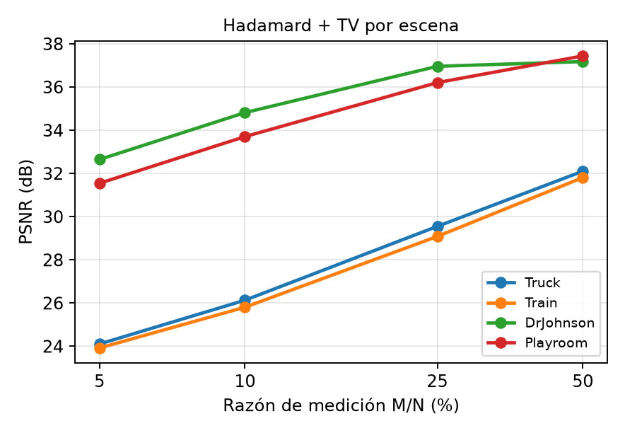{fig-alt="PSNR con Hadamard más TV para cada escena frente a la razón de medición."}
:::

::: points
::: fragment
Al 5 %: **23,9 dB** (Train) frente a **32,6 dB** (DrJohnson).
:::

::: fragment
El **control de remuestreo** muestra la misma separación: 37,7 y 38,1 dB frente a 44,9 y 43,5 dB.
:::

::: fragment
Hipótesis (sin verificar): Deep Blending tiene mayor resolución nativa y se suaviza al llevarla a la rejilla.
:::
:::
::::

::: notes
Las curvas son casi paralelas: reducir mediciones cuesta lo mismo en todas las escenas, pero el nivel base cambia. Conviene validar siempre con varias escenas.
:::

## Qué hace cada reconstrucción con la misma medición

::: eyebrow
Resultados · Truck al 10 %
:::

::: {.image-frame .fig-wide}
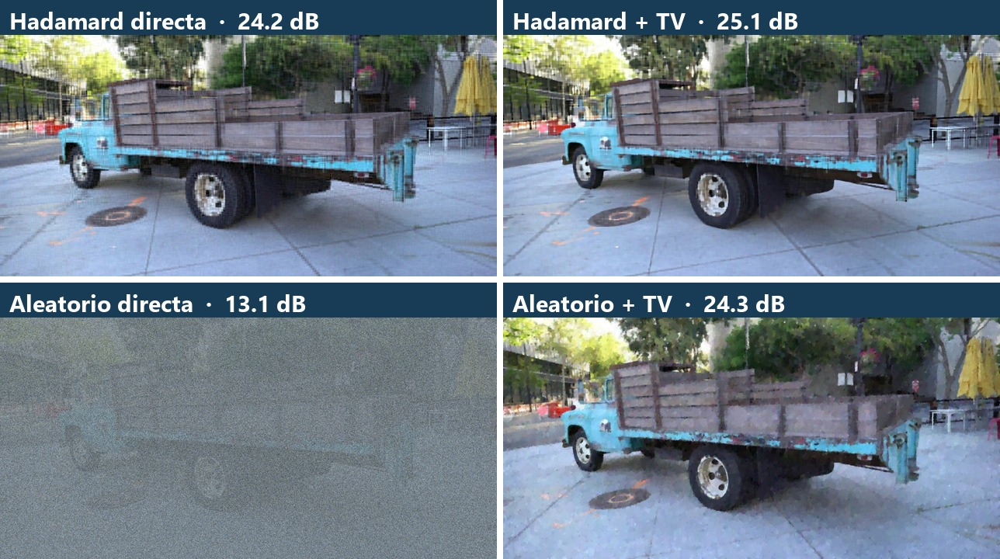{fig-alt="Misma vista al 10 por ciento: Hadamard directa, Hadamard más TV, aleatorio directa y aleatorio más TV."}
:::

::::: {.points .points-row}
::: fragment
Aleatorio + directa: **ruido** sin estructura.
:::

::: fragment
Hadamard + directa: imagen con **artefactos de bloque**.
:::

::: fragment
Con TV los bordes se limpian en ambos patrones.
:::
:::::

::: notes
La misma medición, cuatro reconstrucciones. La diferencia entre filas es el patrón; entre columnas, el método.
:::

## 3DGS parte de una nube de puntos y la convierte en gaussianas

::: eyebrow
Motivación · De puntos a gaussianas \[9\]
:::

:::: two-col
::: {.image-frame}
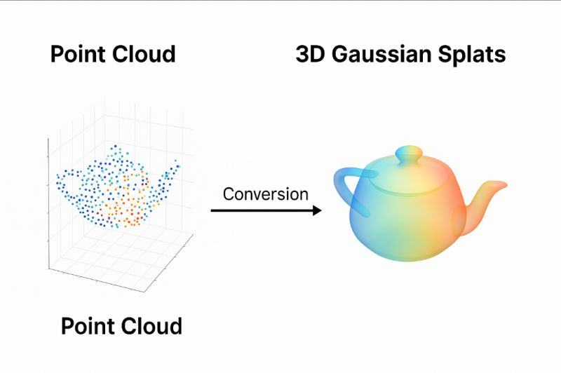{fig-alt="Una nube de puntos de una tetera se convierte en una representación con gaussianas 3D."}

::: image-caption
Ilustración conceptual; sin fuente identificada.
:::
:::

::: points
::: fragment
**COLMAP** entrega las poses y una nube de puntos dispersa (**136 029** puntos en Truck).
:::

::: fragment
Cada punto se inicializa como una **gaussiana 3D** con color y opacidad.
:::

::: fragment
La optimización las **mueve, estira, divide y poda** hasta reproducir las vistas.
:::
:::
::::

::: notes
Es el punto de partida de 3DGS. La nube de Structure from Motion de Truck tiene 136 029 puntos; cada uno se convierte en una gaussiana y el control adaptativo de densidad añade y elimina gaussianas durante el entrenamiento.
:::

## El destino de las vistas: 3D Gaussian Splatting

::: eyebrow
Motivación · Del 2D al 3D \[9\]
:::

::: {.image-frame .fig-wide}
{fig-alt="Pipeline de 3D Gaussian Splatting: nube SfM, inicialización, proyección, rasterizador diferenciable, pérdida y control adaptativo de densidad."}
:::

::: image-caption
Pipeline de 3D-GS. Figura tomada del material de ejemplo de la presentación; verificar su fuente antes de exponer.
:::

::: notes
3DGS parte de una nube de puntos de Structure from Motion con COLMAP, coloca una gaussiana por punto, las proyecta, las rasteriza de forma diferenciable, compara el render con las imágenes y ajusta los parámetros. Además poda y densifica gaussianas durante el entrenamiento.
:::

## De gaussianas 3D a una imagen: proyectar y mezclar

::: eyebrow
Motivación · Renderizado de 3DGS \[9\]
:::

::: {.image-frame .fig-wide}
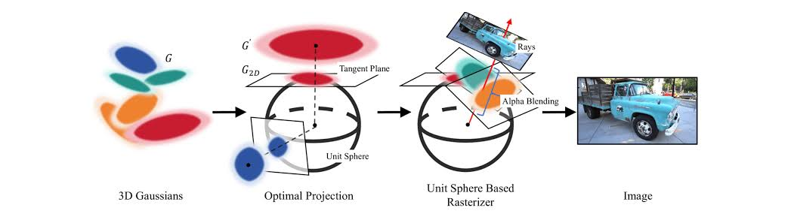{fig-alt="Gaussianas 3D, proyección sobre el plano de la imagen, rasterizador con mezcla alfa y la imagen resultante de la escena Truck."}
:::

::: image-caption
Variante con proyección sobre la esfera unitaria. Fuente: material de ejemplo; verificar antes de exponer.
:::

::::: {.points .points-row}
::: fragment
La escena es un conjunto de **gaussianas 3D** con color y opacidad.
:::

::: fragment
Cada una se **proyecta** al plano de la imagen como una elipse 2D.
:::

::: fragment
Se **mezclan con alfa**, de adelante hacia atrás, para formar cada píxel.
:::
:::::

::: notes
Es la misma escena Truck que usamos en los experimentos 2D. El render es diferenciable, así que la pérdida contra la imagen real ajusta posición, forma, color y opacidad de cada gaussiana.
:::

## Cada gaussiana es un elipsoide con color y opacidad

::: eyebrow
Motivación · Representación de 3DGS \[9\]
:::

:::: stack
::: equation-card
[Gaussiana 3D y covarianza]{.eq-label}

$$G(\mathbf{x})=\exp\!\Big(-\tfrac12(\mathbf{x}-\boldsymbol{\mu})^{\top}\mathbf{\Sigma}^{-1}(\mathbf{x}-\boldsymbol{\mu})\Big),\quad \mathbf{\Sigma}=\mathbf{R}\mathbf{S}\mathbf{S}^{\top}\mathbf{R}^{\top}$$

[Proyección a la imagen]{.eq-label}

$$\mathbf{\Sigma}'=\mathbf{J}\mathbf{W}\mathbf{\Sigma}\mathbf{W}^{\top}\mathbf{J}^{\top}$$
:::

::: equation-card
[Composición $\alpha$ de $i$ gaussianas ordenadas]{.eq-label}

$$C=\sum_{i}c_i\,\alpha_i\prod_{j<i}(1-\alpha_j)$$

[Pérdida de entrenamiento]{.eq-label}

$$\mathcal{L}=(1-\lambda)\,\mathcal{L}_1+\lambda\,\mathcal{L}_{\text{D-SSIM}},\quad \lambda=0{,}2$$
:::
::::

::: note-box
**59 parámetros** por gaussiana: posición (3), rotación (4), escala (3), opacidad (1) y armónicos esféricos (48).
:::

::: notes
La covarianza se factoriza en rotación y escala para mantenerla semidefinida positiva. La proyección usa el jacobiano de la transformación afín local, siguiendo el splatting EWA de Zwicker. El color se compone de adelante hacia atrás con alfa. La pérdida combina L1 y D-SSIM con lambda 0.2, como en el artículo de Kerbl.
:::

## Cómo se conectan la SPC y 3DGS en este proyecto

::: eyebrow
Motivación · Flujo completo
:::

::::: closing-points
::: fragment
[1 · Medir]{.kicker}

Simular la SPC en cada vista con razón $r$ y reconstruirla (directa o TV).
:::

::: fragment
[2 · Preparar]{.kicker}

Conservar los **nombres y poses COLMAP** del dataset y filtrar `images.bin` al usar un subconjunto.
:::

::: fragment
[3 · Entrenar y comparar]{.kicker}

Entrenar 3DGS con las vistas degradadas y evaluar contra el **original**: ¿cómo se propaga el error a 3D?
:::
:::::

::: note-box
Referencia del artículo de 3DGS en Truck: **25,19 dB** / SSIM 0,879 / LPIPS 0,148 a 30 000 iteraciones, en una GPU A6000.
:::

::: notes
Este trabajo cubre el paso 1. Los pasos 2 y 3 están implementados en el repositorio: un runner de entrenamiento con reanudación desde checkpoint y registro de VRAM. Falta ejecutarlos con las corridas SPC y validar primero el baseline contra el artículo.
:::

## Alcance, limitaciones y conclusiones

::: eyebrow
Análisis crítico y conclusiones
:::

::::: closing-points
::: fragment
[Aporta]{.kicker}

Simulación SPC cercana a la resolución nativa, con ruido de DMD, y comparación de **patrones y reconstrucción**.
:::

::: fragment
[Limitaciones]{.kicker}

Vistas ya capturadas (JPEG), medición en **sRGB**, escena estática, **pocas vistas**; en 3D, **poses y nube del GT** (cota optimista).
:::

::: fragment
[Siguiente paso]{.kicker}

Ejecutar 3DGS con las corridas SPC y medir la propagación 2D → 3D; re-estimar poses sin el GT.
:::
:::::

::: note-box
Hadamard ordenado + TV es la mejor combinación en las tres métricas (34,6 dB al 50 %); la TV es **imprescindible** con patrones aleatorios (13,6 → 26,5 dB al 5 %).
:::

::: notes
La conclusión se apoya en el promedio de las cuatro escenas. Las limitaciones principales son que las vistas ya son imágenes capturadas y que para 3D se usarían las poses del dataset, algo que una SPC real no tendría.
:::

## Referencias {visibility="uncounted"}

::: eyebrow
Respaldo · Numeración de esta presentación
:::

::: references
**\[1\]** Duarte et al., «Single-pixel imaging via compressive sampling», *IEEE SPM*, 2008.

**\[2\]** Edgar, Gibson y Padgett, «Principles and prospects for single-pixel imaging», *Nat. Photonics*, 2019.

**\[3\]** Donoho, «Compressed sensing», *IEEE Trans. Inf. Theory*, 2006.

**\[4\]** Sun et al., «3D computational imaging with single-pixel detectors», *Science*, 2013.

**\[5\]** Zhang et al., «Hadamard single-pixel imaging versus Fourier single-pixel imaging», *Opt. Express*, 2017.

**\[6\]** Yu, «Super sub-Nyquist single-pixel imaging by means of cake-cutting Hadamard basis sort», *Sensors*, 2019.

**\[7\]** Rudin, Osher y Fatemi, «Nonlinear total variation based noise removal algorithms», *Physica D*, 1992.

**\[8\]** Beck y Teboulle, «A fast iterative shrinkage-thresholding algorithm», *SIAM J. Imaging Sci.*, 2009.

**\[9\]** Kerbl et al., «3D Gaussian Splatting for Real-Time Radiance Field Rendering», *ACM TOG*, 2023.

**\[10\]** Knapitsch et al., «Tanks and Temples», *ACM TOG*, 2017; Hedman et al., «Deep Blending», *ACM TOG*, 2018.
:::

::: notes
Respaldo: no se presenta salvo que pidan una referencia.
:::

##  {.hero-slide}

:::::::: title-hero
::: eyebrow
INF449 · Fotografía Computacional · Proyecto final
:::

::: hero-paper
Comprimir la captura:\
cámara de un píxel y reconstrucción 2D
:::

::: hero-authors
Francisco Alfaro · Ayrton Perez
:::

::: hero-meta
Universidad Técnica Federico Santa María · Departamentos de Electrónica e Informática

Código: github.com/fralfaro/inf449-proyecto
:::
::::::::

::: notes
Muchas gracias; quedamos a disposición para sus preguntas.
:::
